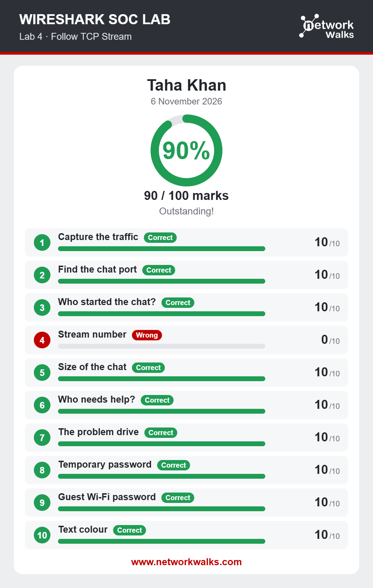
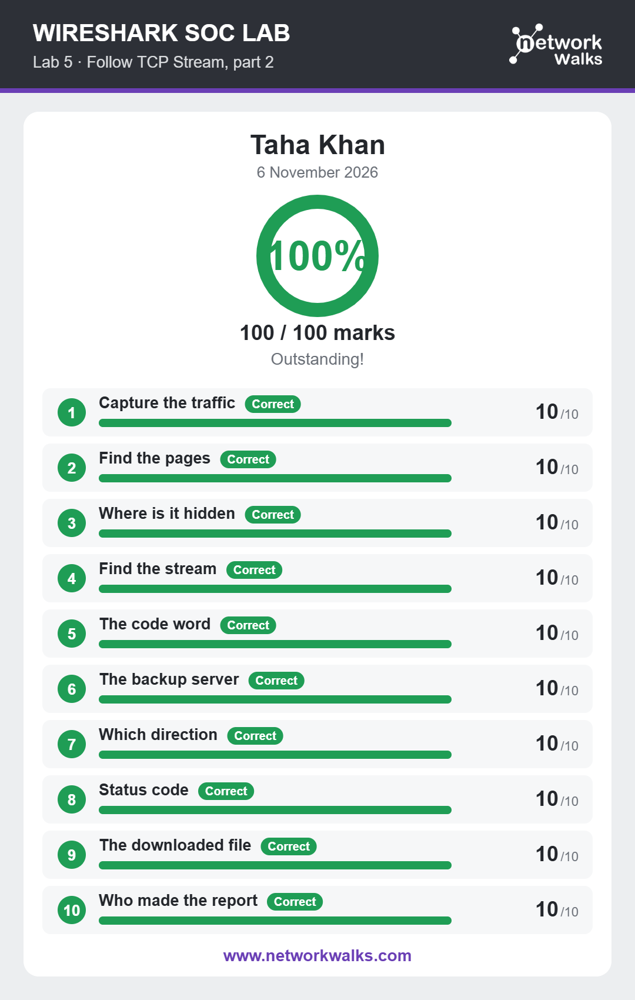
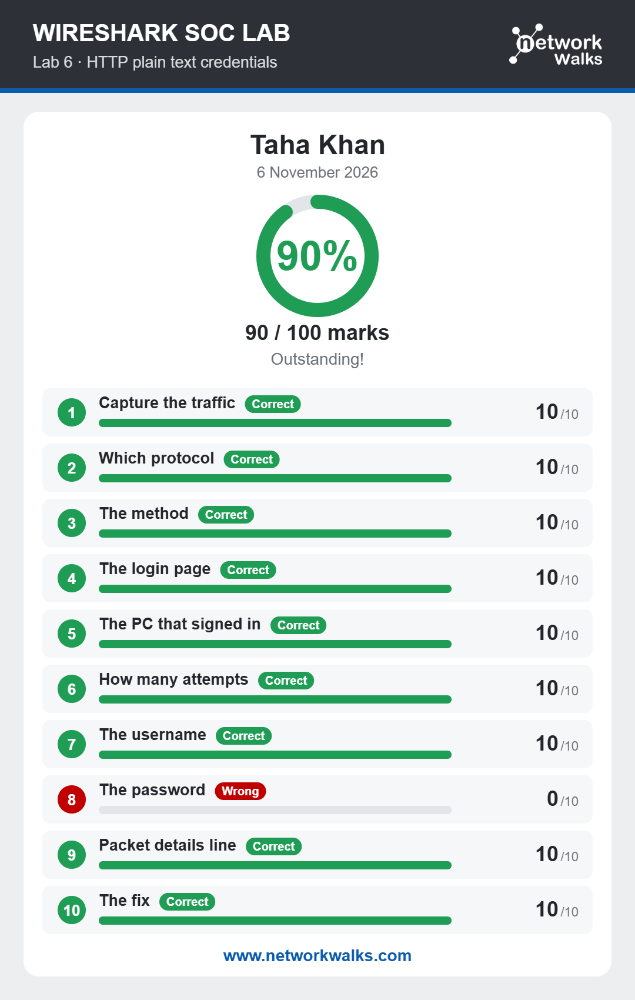
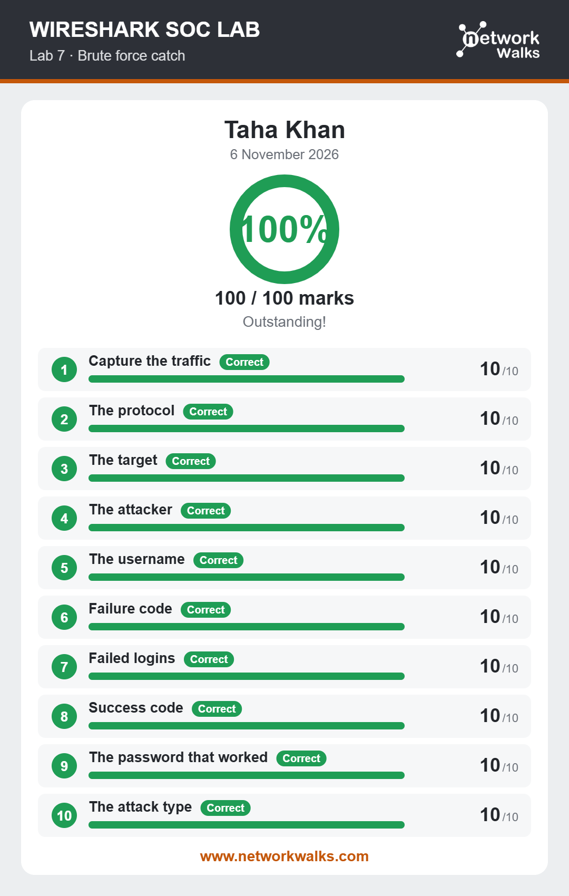
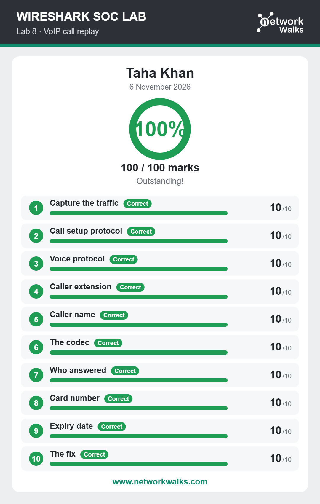

# Wireshark SOC Labs — Week 1 Project

A hands-on **Security Operations Center (SOC) and network traffic analysis** practice project completed using Wireshark labs from NetworkWalks.

## Project overview

This repository documents the results of six practical labs focused on examining network captures, understanding network conversations, and recognizing common security events.

## Lab results

| Lab | Topic | Score |
|---|---|---:|
| 03 | Identify the Attacker's IP | 100/100 |
| 04 | Follow TCP Stream | 90/100 |
| 05 | Follow TCP Stream, Part 2 | 100/100 |
| 06 | HTTP Plain-Text Credentials | 90/100 |
| 07 | Brute-Force Attack Detection | 100/100 |
| 08 | VoIP Call Replay | 100/100 |
| **Total** | **6 labs** | **580/600 (96.67%)** |

## Skills practiced

- Capturing and examining network traffic
- Filtering traffic and identifying SYN packets
- Identifying suspected attacker and target IP addresses
- Following TCP streams to reconstruct conversations
- Locating hidden information in network traffic
- Recognizing HTTP plain-text credential exposure
- Identifying repeated login attempts associated with brute-force activity
- Examining VoIP call traffic and call details

## Repository structure

```text
wireshark-soc-labs/
├── README.md
├── .gitignore
└── results/
    ├── Lab-03-Identify-Attackers-IP.png
    ├── Lab-04-Follow-TCP-Stream.png
    ├── Lab-05-Follow-TCP-Stream-Part-2.png
    ├── Lab-06-HTTP-Plain-Text-Credentials.png
    ├── Lab-07-Brute-Force-Detection.png
    └── Lab-08-VoIP-Call-Replay.png
```

## Results

### Lab 03 — Identify the Attacker's IP


### Lab 04 — Follow TCP Stream


### Lab 05 — Follow TCP Stream, Part 2


### Lab 06 — HTTP Plain-Text Credentials


### Lab 07 — Brute-Force Attack Detection


### Lab 08 — VoIP Call Replay


## Learning outcome

These exercises provided practical exposure to Wireshark-based packet analysis and introductory SOC investigation workflows. The results document the completion scores for each lab.

## Learning resources and acknowledgements

The exercises were completed using the NetworkWalks Wireshark lab material:

- https://networkwalks.com/wireshark/

This repository is a personal learning record. NetworkWalks owns its original lab content and branding. The screenshots are included to document the completed exercise results.

## Responsible-use note

All packet-analysis practice should be performed only on supplied lab captures, systems you own, or networks for which you have explicit authorization. Do not inspect or capture traffic on networks without permission.
